# Phase 5 Cross-Module Event Flow

All 8 consumers below live under
`PlantSafety.Infrastructure\Messaging\Consumers\CrossModuleOrchestration\` and inherit
`CrossModuleIdempotentConsumerBase<TEvent>` (`CrossModuleIdempotentConsumerBase.cs` in the same
root), which provides idempotent dispatch keyed by `ResolveEventId(message)` and a
`DispatchAsync(command, description, cancellationToken)` helper. Registration for all 8 is in
`CrossModuleOrchestrationConsumerRegistration.cs`.

They implement three Handbook §3 pairings plus one §3.4 aggregation group, each with two
directions (a forward escalation and a feedback/closure loop):

- **§3.1 Maintenance <-> Predictive Maintenance** — `MaintenancePrediction\`
- **§3.2 Production Tracking <-> Scheduling** — `ProductionScheduling\`
- **§3.3 RiskManagement <-> ContinuousImprovement** — `RiskContinuousImprovement\`
- **§3.4 Intelligence <-> everything (aggregation)** — `IntelligenceAggregation\`

## Consumer reference table

| # | Consumer | Folder | Consumes | Triggers |
|---|---|---|---|---|
| 1 | `PredictiveMaintenanceEscalationConsumer` | `MaintenancePrediction` | `PredictiveMaintenanceAlertRaisedEvent` (`Operational.PredictiveMaintenance`) | `SchedulePreventiveMaintenanceTaskCommand` |
| 2 | `MaintenanceCompletionFeedbackConsumer` | `MaintenancePrediction` | `PreventiveMaintenanceTaskCompletedEvent` (`Operational.PreventiveMaintenance`) | `CreateDataLakeActivityCommand` (dataset `PredictiveMaintenance.CompletedTaskFeedback`, zone `Curated`) |
| 3 | `ProductionAnomalyReprioritizationConsumer` | `ProductionScheduling` | `MachineProcessMonitoringAnomalyFlaggedEvent` (`Observability.MachineProcessMonitoring`) | in-process `SchedulingReprioritizationOrchestrator.ReprioritizeForProductionStateChange` (no persistence yet) + `CreateDataLakeActivityCommand` (dataset `Scheduling.ProductionReprioritization`, zone `Curated`) |
| 4 | `SchedulingKpiFeedbackConsumer` | `ProductionScheduling` | `PredictiveMaintenanceAlertActionScheduledEvent` (`Operational.PredictiveMaintenance`) | in-process `ProductionKpiEngine.ComputeSnapshot` + `CreateDataLakeActivityCommand` (dataset `Analytics.ProductionKpiRecompute`, zone `Curated`) |
| 5 | `RiskEscalationCapaConsumer` | `RiskContinuousImprovement` | `RiskScoredEvent` (`RiskManagement`), only when `Level` is High/Critical | `ICorrectiveActionRepository.CreateAsync` (new CAPA, `SourceEventType = "RiskManagement.Risk"`) |
| 6 | `CapaCompletionRiskReductionConsumer` | `RiskContinuousImprovement` | `CorrectiveActionCompletedEvent` (`ContinuousImprovement.CAPA`), only when the CAPA's `SourceEventType == "RiskManagement.Risk"` | `ValidateRiskEffectivenessCommand` |
| 7 | `InsufficientMitigationInsightConsumer` | `IntelligenceAggregation` | `RiskEffectivenessValidatedEvent` (`RiskManagement`), only when `IsAcceptable == false` | `CreatePredictiveSafetyAlertCommand` (`RiskCategory = "InsufficientMitigation"`) |
| 8 | `PredictiveSafetyAlertDashboardFeedConsumer` | `IntelligenceAggregation` | `PredictiveSafetyAlertCreatedEvent` (`Intelligence.PredictiveSafety`) | `CreateDataLakeActivityCommand` (dataset `Analytics.PredictiveSafetyAlertFeed`, zone `ML`) |

All 8 consumers guard on `TenantId == Guid.Empty` (from `context.GetEnvelopeTenantId()`, or the
event's own `TenantId` field for #8) and skip cross-module dispatch with a warning log if the
tenant cannot be resolved — this is the standard multi-tenant safety guard for this consumer family.

## Mermaid flowchart

```mermaid
flowchart LR
    subgraph S31["Sec 3.1 Maintenance <-> Predictive Maintenance"]
        E1[PredictiveMaintenanceAlertRaisedEvent]
        C1[PredictiveMaintenanceEscalationConsumer]
        CMD1[SchedulePreventiveMaintenanceTaskCommand]
        E2[PreventiveMaintenanceTaskCompletedEvent]
        C2[MaintenanceCompletionFeedbackConsumer]
        CMD2[CreateDataLakeActivityCommand\nPredictiveMaintenance.CompletedTaskFeedback]

        E1 --> C1 --> CMD1
        E2 --> C2 --> CMD2
    end

    subgraph S32["Sec 3.2 Production Tracking <-> Scheduling"]
        E3[MachineProcessMonitoringAnomalyFlaggedEvent]
        C3[ProductionAnomalyReprioritizationConsumer]
        ORC3[SchedulingReprioritizationOrchestrator\nReprioritizeForProductionStateChange]
        CMD3[CreateDataLakeActivityCommand\nScheduling.ProductionReprioritization]
        E4[PredictiveMaintenanceAlertActionScheduledEvent]
        C4[SchedulingKpiFeedbackConsumer]
        ORC4[ProductionKpiEngine.ComputeSnapshot]
        CMD4[CreateDataLakeActivityCommand\nAnalytics.ProductionKpiRecompute]

        E3 --> C3 --> ORC3 --> CMD3
        E4 --> C4 --> ORC4 --> CMD4
    end

    subgraph S33["Sec 3.3 RiskManagement <-> ContinuousImprovement"]
        E5[RiskScoredEvent\nHigh/Critical only]
        C5[RiskEscalationCapaConsumer]
        CMD5[ICorrectiveActionRepository.CreateAsync\nnew CAPA]
        E6[CorrectiveActionCompletedEvent\nSourceEventType=RiskManagement.Risk]
        C6[CapaCompletionRiskReductionConsumer]
        CMD6[ValidateRiskEffectivenessCommand]

        E5 --> C5 --> CMD5
        E6 --> C6 --> CMD6
    end

    subgraph S34["Sec 3.4 Intelligence aggregation"]
        E7[RiskEffectivenessValidatedEvent\nIsAcceptable=false only]
        C7[InsufficientMitigationInsightConsumer]
        CMD7[CreatePredictiveSafetyAlertCommand]
        E8[PredictiveSafetyAlertCreatedEvent]
        C8[PredictiveSafetyAlertDashboardFeedConsumer]
        CMD8[CreateDataLakeActivityCommand\nAnalytics.PredictiveSafetyAlertFeed]

        E7 --> C7 --> CMD7
        E8 --> C8 --> CMD8
    end

    %% Cross-loop links showing how the loops actually chain together at runtime
    CMD5 -.->|CAPA later completed| E6
    CMD6 -.->|ValidateRiskEffectivenessCommand raises| E7
    CMD7 -.->|CreatePredictiveSafetyAlertCommand raises| E8
```

## Notes on the wiring (grounded in the code, not idealized)

- **#3 has no persistence to key off yet.** `PredictiveScheduling` has no aggregate/event store, so
  `ProductionAnomalyReprioritizationConsumer` synthesizes a minimal in-memory `SchedulableTask`,
  runs the real `SchedulingReprioritizationOrchestrator`, and only persists the *outcome* via a
  DataLake activity record. This is a documented, tracked gap (see the file's own header comment),
  not an oversight.
- **#4 uses conservative fixed estimates**, not real per-run telemetry (`PlannedWindow`,
  `EstimatedDowntime`, `IdealCycleTime`, unit counts are hardcoded constants) — flagged in the file
  header as pending a real production-run data source.
- **#5 -> #6 correlation has no FK.** CAPA rows created by `RiskEscalationCapaConsumer` carry
  `SourceEventType = "RiskManagement.Risk"` / `SourceEventId = RiskId` as a soft link;
  `CapaCompletionRiskReductionConsumer` resolves the originating risk by reading those two columns
  back off the CAPA read model, not via a schema-level foreign key.
- **#2 has the same soft-correlation gap** between `PreventiveMaintenanceTask` and its originating
  `PredictiveMaintenanceAlert` — no FK exists; correlation is via `CorrelationId` propagated onto
  the outbox message (`System.OutboxMessages.CorrelationId`), not a domain relationship.
- **#8's event already carries `TenantId`/`GeneratedBy` directly** on the event payload (unlike the
  other 7, which rely on envelope headers), so the consumer prefers the event's own fields and only
  falls back to `context.GetEnvelopeTenantId()`/`GetEnvelopeActorId()`.

## Source files

- `D:\PlantSafety\source\PlantSafety\PlantSafety.Infrastructure\Messaging\Consumers\CrossModuleOrchestration\CrossModuleIdempotentConsumerBase.cs`
- `D:\PlantSafety\source\PlantSafety\PlantSafety.Infrastructure\Messaging\Consumers\CrossModuleOrchestration\CrossModuleOrchestrationConsumerRegistration.cs`
- `D:\PlantSafety\source\PlantSafety\PlantSafety.Infrastructure\Messaging\Consumers\CrossModuleOrchestration\MaintenancePrediction\PredictiveMaintenanceEscalationConsumer.cs`
- `D:\PlantSafety\source\PlantSafety\PlantSafety.Infrastructure\Messaging\Consumers\CrossModuleOrchestration\MaintenancePrediction\MaintenanceCompletionFeedbackConsumer.cs`
- `D:\PlantSafety\source\PlantSafety\PlantSafety.Infrastructure\Messaging\Consumers\CrossModuleOrchestration\ProductionScheduling\ProductionAnomalyReprioritizationConsumer.cs`
- `D:\PlantSafety\source\PlantSafety\PlantSafety.Infrastructure\Messaging\Consumers\CrossModuleOrchestration\ProductionScheduling\SchedulingKpiFeedbackConsumer.cs`
- `D:\PlantSafety\source\PlantSafety\PlantSafety.Infrastructure\Messaging\Consumers\CrossModuleOrchestration\RiskContinuousImprovement\RiskEscalationCapaConsumer.cs`
- `D:\PlantSafety\source\PlantSafety\PlantSafety.Infrastructure\Messaging\Consumers\CrossModuleOrchestration\RiskContinuousImprovement\CapaCompletionRiskReductionConsumer.cs`
- `D:\PlantSafety\source\PlantSafety\PlantSafety.Infrastructure\Messaging\Consumers\CrossModuleOrchestration\IntelligenceAggregation\InsufficientMitigationInsightConsumer.cs`
- `D:\PlantSafety\source\PlantSafety\PlantSafety.Infrastructure\Messaging\Consumers\CrossModuleOrchestration\IntelligenceAggregation\PredictiveSafetyAlertDashboardFeedConsumer.cs`
