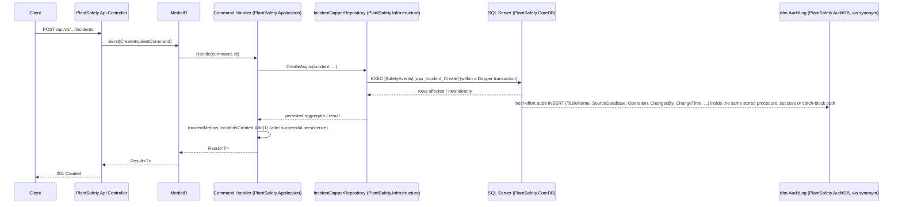
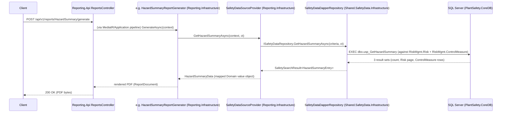

# PlantSafety Architecture

**Date:** 2026-07-27
**Scope:** `C:\Users\dross\source\PlantSafety\**` (API, Application, Domain, Infrastructure, SharedKernel).

This document describes PlantSafety's real, current bounded contexts, its
dependencies on shared cross-module libraries, and the write/read data flows
that connect it to those shared modules and to the central Reporting module.
It reflects the state of the codebase as of the end of the Section 7
modernization checklist (Shared.AuditLogging extraction, Shared.SafetyData
build-out, Reporting's 4 new safety report types, and the SafetyEvents/
ContinuousImprovement stored-procedure bug fixes). It is descriptive, not
aspirational — see "Known gaps" at the end for places where behavior still
falls short of the ideal.

## 1. Domain responsibilities (bounded contexts)

PlantSafety is a single deployable (`PlantSafety.Api` / `PlantSafety.Application`
/ `PlantSafety.Domain` / `PlantSafety.Infrastructure`) organized as a set of
folder-scoped bounded contexts under `PlantSafety.Domain/*`. Each context owns
its own aggregates, domain events, repositories interfaces, and (in
Infrastructure) Dapper repositories + stored procedures. The contexts with
real aggregates (as opposed to stub markers awaiting a future build-out) are:

| Context (`PlantSafety.Domain/<Folder>`) | Owns | Notes |
|---|---|---|
| `AccidentManagement` | `Accident` aggregate, `CorrectiveAction`/`AccidentHistoryEntry` entities, investigation lifecycle (`InvestigationPhase`, `RootCauseCategory`), archival policy | Full aggregate with events (`AccidentCreatedEvent`, `AccidentArchivedEvent`, investigation events) |
| `RiskManagement` | `Risk` aggregate, `ControlMeasure`/`RiskHistoryEntry` entities, `RiskScore` value object, archival policy | Full aggregate with events (`RiskCreatedEvent`, `RiskArchivedEvent`, assessment events) |
| `SafetyEvents` | Multiple sub-contexts under one folder: `IncidentManagement` (full aggregate — the "Incident" feature referenced throughout this doc set), `EmergencyManagement` (full aggregate), `Observation` (full aggregate); `CrisisManagement`, `DrillsAndExercises`, `NearMisses`, `RootCauseAnalysis` are stub markers only (`*Stub.cs`, no aggregate yet) | `ISafetyEventRepository` is the shared read contract; each sub-context also has its own repository interface |
| `ContinuousImprovement` | `CAPA` folder now owns a real `CorrectiveAction` aggregate (`PlantSafety.Domain/ContinuousImprovement/CAPA/Aggregates/CorrectiveAction.cs`, added 2026-07-27, replacing the prior `CAPAStub.cs` placeholder) modeling the write-side `[ContinuousImprovement].[CorrectiveAction]` table (`usp_CorrectiveAction_Create/GetById/List`). This is a *different* table from `[ContinuousImprovement].[CAPA]` (Reporting's read-model, `usp_CAPA_GetActions.sql`, `CAPADapperRepository.cs`) — see §5 for the full CorrectiveAction lifecycle/events/invariants and the disambiguation of the two "CAPA" concepts | `RCA` (Root Cause Analysis) is a stub marker only |
| `Operational` / `OperationalSafety` / `Operations` (API layer: `PlantSafety.Api/Operations`) | Cross-cutting ops surfaces: Feature Flags (`Operations/Configuration`), System Health, Audit Viewer (`Operations/AuditViewer`), Backup (`CrossDomain/Backup`) | Not a single Domain aggregate — mostly Application/Infrastructure services over shared cross-cutting tables |
| `Compliance` | `Procedures`/`ProceduresHistoryEntry`-descended sub-aggregates (`SafetyProcedures.*`), `CAPATriggers` | |
| `Checklists`, `Alerts`, `Analytics`, `Dashboards`, `Scorecards`, `Scheduling` | Supporting/derived aggregates and read models used across contexts | |
| `ContractorSafety`, `ContractorVisitor`, `EmployeeSafety`, `MachineSafety`, `PermitToWork`, `PPE`, `SafetyCulture`, `SafetyPolicies`, `SafetyProcedures`, `EnvironmentalHealth`, `HumanFactors`, `WorkerWellBeing`, `Sustainability`, `PlanningProjects`, `ProcessManagement`, `Financials`, `DigitalTwin`, `Governance`, `EnterpriseFabric` | Additional bounded contexts, each with their own folder under `PlantSafety.Domain`, `PlantSafety.Application`, `PlantSafety.Infrastructure` | Not exhaustively detailed here; same folder-per-context convention applies uniformly |
| `AiGovernance`, `AiSafetyIntelligence`, `Intelligence`, `Observability` | AI/ML- and telemetry-adjacent contexts | Overlaps with the separate `Intelligence.Domain`/`PlantSafety.Intelligence` projects at the repo root, which house a larger, separately-scoped AI subsystem (`AIInvestigations`, `AITraining`, `DataLake`, `FeatureEngineering`, `ModelRegistry`, `PredictiveSafety`) — out of scope for this document |

`PlantSafety.SharedKernel` (not to be confused with the cross-repo `Shared\*`
modules — see §2) provides the intra-module base types every context above
depends on: `Base`/`Domain` (aggregate root/entity/value-object base classes),
`Events` (domain event base + dispatch abstractions), `Audit` (PlantSafety-local
audit value objects, distinct from the shared `dbo.AuditLog` table — see
`docs/architecture/audit-logging.md`), `Outbox`, `MultiTenancy`, `Identifiers`
(strongly-typed IDs), `Primitives` (`UtcTimestamp`, etc.).

### Domain event note: Accident/Risk `Archive()`

Both `Accident.Archive(...)` and `Risk.Archive(...)`
(`PlantSafety.Domain/AccidentManagement/Aggregates/Accident.cs`,
`PlantSafety.Domain/RiskManagement/Aggregates/Risk.cs`) now raise a domain
event (`AccidentArchivedEvent` / `RiskArchivedEvent`) on the archive
transition, closing a previously-identified gap where archival was a silent
state mutation with no corresponding event for downstream handlers/outbox
consumers to react to.

## 2. Dependencies on shared modules

PlantSafety is not a fully isolated module — it depends on two cross-repo
shared libraries that live outside `PlantSafety\` at `C:\Users\dross\source\Shared\`:

- **`Shared.AuditLogging`** (`Shared\AuditLogging\`) — owns the C# read
  contract (`IAuditLogRepository`, `AuditLogEntry`, `AuditLogSearchCriteria`,
  `AuditLogSearchResult`) and Dapper implementation for the shared,
  cross-database, append-only `dbo.AuditLog` table. PlantSafety's Audit
  Viewer UI (`PlantSafety.Api/Operations/AuditViewer`,
  `PlantSafety.Application`'s `SearchAuditLogQuery`/`SearchAuditLogQueryHandler`)
  consumes this via `services.AddSharedAuditLogging(configuration)`, called
  from `PlantSafety.Infrastructure/DependencyInjection/
  InfrastructureServiceRegistration.cs`. See
  `docs/architecture/audit-logging.md` for full detail.
- **`Shared.SafetyData`** (`Shared\SafetyData\`) — owns a *read-only* contract
  (`ISafetyDataRepository`) over PlantSafety's own `RiskMgmt.Risk`/
  `RiskMgmt.ControlMeasure`/`ContinuousImprovement.CAPA` tables in
  `PlantSafety.CoreDB`, intended for **other** modules (currently only
  Reporting) to read PlantSafety data without a direct project reference.
  **PlantSafety itself does not consume `Shared.SafetyData`** — PlantSafety
  continues to read/write those tables directly through its own aggregates
  and Dapper repositories (`RiskDapperRepository`, `CAPADapperRepository`,
  etc.). `Shared.SafetyData` exists purely as an outbound-facing read surface
  for Reporting.

Both shared modules exist specifically so Reporting (and any other future
consumer) never takes a direct project reference on `PlantSafety.*` — a hard
module-boundary rule in this solution. PlantSafety, in turn, has **zero**
project references pointing the other way (it does not reference
`Reporting.*` at all).

### Relationship to Reporting

**Reporting reads PlantSafety data via `Shared.SafetyData` and
`Shared.AuditLogging` — it never queries PlantSafety's databases directly and
never references a `PlantSafety.*` project.** See §4 and
`docs/architecture/reporting-integration.md` for the full detail of how
Reporting's 4 new safety report types consume this data.

## 3. Data flow diagrams

### 3.1 Write flow — API → MediatR command → Dapper repository → stored procedure → SQL Server (+ AuditLog side effect)

This is the canonical write path shared by every PlantSafety context (shown
here using the Incident feature as the concrete example, since it was the
subject of the SafetyEvents Incident stored-procedure fix):

Key points, grounded in the actual code:

- Stored procedures live under `PlantSafety.Infrastructure/<Context>/Sql/Procedures/*.sql`
  and are invoked by name through a shared `commandExecutor.ExecuteAsync(conn, "[Schema].[usp_Name]", parameters, tx)`
  helper (e.g. `IncidentDapperRepository.cs` calls
  `[SafetyEvents].[usp_Incident_Create]` / `usp_Incident_Update` /
  `usp_Incident_SoftDelete`).
- The audit-log write is a **side effect embedded in the stored procedure
  itself** (an `INSERT INTO dbo.AuditLog` — via the per-database `dbo.AuditLog`
  synonym — in the success path and/or the `CATCH` block), not a separate
  application-layer call. This is the pattern documented in
  `docs/architecture/audit-logging.md` §2.
- All PlantSafety persistence in this solution goes through Dapper + stored
  procedures. There is no EF Core `DbContext` anywhere in
  `PlantSafety.Infrastructure` — EF Core package references and any residual
  EF-based code paths were removed as part of this modernization effort.
- Connection acquisition, retry, and transaction handling follow a single
  standardized pattern (a shared connection factory + retry policy +
  `IDbTransaction` wrapper used uniformly by every Dapper repository) rather
  than each repository rolling its own.
- `IncidentMetrics.IncidentsCreated` (`PlantSafety.Application/Features/
  SafetyEvents/Metrics/IncidentMetrics.cs`) is a `System.Diagnostics.Metrics.Counter<long>`
  incremented once per successfully persisted Incident — the one new metrics
  instrument added by this modernization pass. No other write paths currently
  have an equivalent counter.

### 3.2 Reporting read flow — Reporting.Api → Shared.SafetyData → PlantSafety's database tables

Reporting never opens a connection to `PlantSafety.CoreDB` itself and never
references a `PlantSafety.*` assembly — the only coupling point is the shared
`Shared.SafetyData.Abstractions.ISafetyDataRepository` contract, backed by
`Shared.SafetyData.Infrastructure.SafetyDataDapperRepository`, which both
Reporting and (indirectly, by virtue of owning the tables) PlantSafety are
aware of. The equivalent flow for the Audit Report (`Reporting`'s pre-existing
5th report type, not one of the 4 new ones) goes through
`Shared.AuditLogging.Abstractions.IAuditLogRepository` against
`PlantSafety.AuditDB` instead — see `docs/architecture/audit-logging.md`.

## 4. Reporting integration summary

Reporting's central `Reporting.Api` module exposes a single generic,
`reportTypeCode`-driven pipeline (`ReportsController` → `ReportType` Smart Enum
→ `ReportGeneratorFactory` → per-type generator/section builder/PDF template).
Four new report type codes were added to that catalog to expose PlantSafety
data, all resolving through `Shared.SafetyData`:

| Report type code | PlantSafety data | Real or stub? |
|---|---|---|
| `HazardSummary` | `RiskMgmt.Risk` + `RiskMgmt.ControlMeasure` via `dbo.usp_GetHazardSummary` | Real |
| `CorrectiveAction` | `ContinuousImprovement.CAPA` via `dbo.usp_GetCorrectiveActions` | Real |
| `SafetyCompliance` | Derived open/closed/overdue rollup over the same two tables above via `dbo.usp_GetSafetyCompliance` | Real (derived, not a dedicated table) |
| `SafetyIncident` | Intended to map to `PlantSafety.Domain.AccidentManagement.Aggregates.Accident` | **Stub** — `SafetyDataSourceProvider.GetSafetyIncidentsAsync` always returns `SafetyIncidentData.Empty`; no shared module exposes PlantSafety incident/accident data to Reporting yet (`Shared.SafetyData` only covers Hazard/CorrectiveAction/Compliance) |

Full detail — data sources, Domain section types, PDF templates, and
confirmation that no new API endpoints were required — is in
`Reporting\docs\safety-reports-integration.md` (see also
`Reporting\docs\audit-report-printing.md` for the pre-existing Audit Report
precedent this pattern followed, and `Shared\SafetyData\docs\README.md` for
the shared module itself).

## 5. IncidentManagement and CorrectiveAction aggregate redesign (2026-07-27)

This section documents the outcome of the refactoring pass that redesigned
`PlantSafety.Domain.SafetyEvents.IncidentManagement.Aggregates.IncidentManagement`
and introduced `PlantSafety.Domain.ContinuousImprovement.CAPA.Aggregates.CorrectiveAction`
to eliminate anemic-aggregate patterns, dead code, and domain-rule drift. Both
redesigns are grounded strictly in the real stored procedures and table
columns that already existed — no speculative states or fields were invented.

### 5.1 IncidentManagement aggregate

**Before:** `PlantSafety.Domain/SafetyEvents/IncidentManagement/Aggregates/IncidentManagement.cs`
was a fully disconnected scaffold: a single parameterless-ish `Create()`
factory, a generic `Created → Active → Completed → Closed → Archived` status
enum matched by nothing in the real database, and eight sibling scaffold
files (`IncidentManagementFactory`, `IIncidentManagementFactory`,
`IncidentManagementArchivalPolicy`, `IncidentManagementLifecycleRules`, the
empty `IncidentManagementService` placeholder, `IncidentManagementSnapshot`,
`IncidentManagementSpecification` + `And`/`Or` combinators, and
`IncidentManagementHistoryEntry`) — all confirmed to have **zero references
anywhere outside their own declaring file**. Its own domain repository
interface (`IIncidentManagementRepository`, `GetByIdAsync`/`ListAsync`/
`AddAsync`/`UpdateAsync`) had **no Infrastructure implementation and no DI
registration**. Meanwhile, the real production Incident write path
(`CreateIncidentCommandHandler`/`UpdateIncidentCommandHandler`/
`DeleteIncidentCommandHandler` → `IIncidentRepository` →
`IncidentDapperRepository` → `usp_Incident_Create`/`usp_Incident_Update`/
`usp_Incident_SoftDelete`) bypassed the Domain aggregate entirely, pushing
primitives straight to Dapper with only Application-layer FluentValidation
guarding required fields.

**After:** the aggregate was rewritten to model the real
`[SafetyEvents].[Incident]` table:

| Lifecycle state | Real trigger | Domain event |
|---|---|---|
| `Reported` (initial) | `Create(...)` — mirrors `usp_Incident_Create` (`DF_Incident_Status` default `N'Reported'`) | `IncidentManagementCreatedEvent` |
| `Reported` (mutated in place) | `UpdateDetails(...)` — mirrors `usp_Incident_Update`'s null-means-unchanged field set (Title/Description/Severity/Location/AssignedInvestigatorId); throws if already `Archived` | `IncidentManagementUpdatedEvent` (new) |
| `Archived` (terminal) | `Archive(deletionReason, ...)` — mirrors `usp_Incident_SoftDelete` (`IsDeleted = 1`, `Status = N'Archived'`, `DeletionReason` required); throws if already `Archived` | `IncidentManagementArchivedEvent` (new, follows the `AccidentArchivedEvent`/`RiskArchivedEvent` convention) |

**Invariants now enforced by the aggregate:** non-empty `TenantId`/`SiteId`/
`Title`/`Description`/`Severity`/`Location`/`ReportedByWorkerId` at Create
(mirrors the table's `NOT NULL` columns); no updates or re-archival once
`Archived` (`IncidentManagementInvalidStatusTransitionException`); non-empty
`DeletionReason` to archive.

**`IncidentClosedEvent` was deliberately NOT added.** The `Incident` table
has a `ClosedAtUtc` column and an *Application-layer* integration event
(`PlantSafety.Application.Features.SafetyEvents.Events.IncidentManagement.
IncidentClosedEvent`) already exists, but neither is ever set/raised by any
stored procedure, command, or handler in the codebase — there is no real
"Close" transition to ground a domain event in. Per the instruction "don't
add an event for a transition that doesn't exist," this was left out and is
flagged here as scaffolding drift for a future, explicit "Close" feature
(new stored procedure + command) rather than silently wired up.

**Removed as dead code** (zero references outside their own file, verified
via repo-wide grep before deletion): `IncidentManagementFactory.cs`,
`IIncidentManagementFactory.cs`, `IIncidentManagementRepository.cs` (the
aggregate-shaped, never-implemented one — not to be confused with the
distinct, real, DI-registered `PlantSafety.Application.SafetyEvents.
IncidentManagement.Repositories.IIncidentManagementRepository`),
`IncidentManagementArchivalPolicy.cs`, `IncidentManagementLifecycleRules.cs`,
`IncidentManagementService.cs`, `IncidentManagementSnapshot.cs`,
`IncidentManagementSpecification.cs`, `IncidentManagementHistoryEntry.cs`.
`PlantSafety.Domain/GlobalUsing.cs` was updated to drop the corresponding
now-empty-namespace `global using` lines.

**Scope decision (rule: prefer the smaller, reversible refactor):** the
production `Create`/`Update`/`Delete` MediatR handlers were **not** rewired
to load/save through this aggregate — that would require adding a read-then-
validate step to `Update`/`Delete` (today's SQL `ISNULL`/`COALESCE`-based
partial-update pattern deliberately avoids a full load), a larger and riskier
change than this pass's scope. The aggregate is a complete, independently
unit-tested model of the same invariants, ready to be the target of a future
handler rewiring; a `Rehydrate(...)` factory was added specifically to
support that follow-up without raising spurious events on load.

### 5.2 CorrectiveAction (CAPA) aggregate

**Before:** `PlantSafety.Domain/ContinuousImprovement/CAPA/CAPAStub.cs`
contained only `public static class CAPAModuleMarker { }` — there was no
Domain aggregate at all. `CreateCorrectiveActionCommandHandler` pushed
primitives straight to `ICorrectiveActionRepository` →
`CorrectiveActionDapperRepository` → `usp_CorrectiveAction_Create`, guarded
only by `CreateCorrectiveActionCommandValidator`. The pre-existing
Application-layer `CorrectiveActionClosedEvent` integration event was never
published by anything, and only `Create`/`GetById`/`List` stored procedures
exist under `PlantSafety.Infrastructure/ContinuousImprovement/Sql/Procedures/`
— no `Update`/`Complete`/`Close` procedure exists yet.

**After:** `PlantSafety.Domain/ContinuousImprovement/CAPA/Aggregates/
CorrectiveAction.cs` models `[ContinuousImprovement].[CorrectiveAction]`
(`CaId`, `SourceEventId`/`SourceEventType`, `Title`, `Description`,
`ActionType`, `Priority`, `AssignedToWorkerId`, `DueAtUtc`, `Status`,
`CompletedAtUtc`). The lifecycle states (`Open`/`InProgress`/
`AwaitingVerification`/`Closed`/`Overdue`) are copied verbatim from the
workflow-status vocabulary already documented on `CorrectiveActionDto.Status`
("e.g., Open, InProgress, AwaitingVerification, Closed, Overdue") — no new
states were invented, and this is a **distinct type** from
`PlantSafety.Domain.AccidentManagement.Enums.CorrectiveActionStatus` (which
models the unrelated, already-correct `Accident`-child `CorrectiveAction`
entity backed by a different table, `[AccidentManagement].[CorrectiveAction]`)
to respect the Maximalist Module Rule's "zero cross-module leakage."

| Lifecycle state | Method | Real/planned trigger | Domain event |
|---|---|---|---|
| `Open` (initial) | `Create(...)` | Real — mirrors `usp_CorrectiveAction_Create` (`DF_CorrectiveAction_Status` default `N'Open'`) | `CorrectiveActionCreatedEvent` |
| `InProgress` | `Start(...)` | Domain-complete, not yet wired to a command/procedure | `CorrectiveActionStartedEvent` |
| `AwaitingVerification` | `Complete(...)` | Domain-complete; sets `CompletedAtUtc` (the one completion-timestamp column the table already has) | `CorrectiveActionCompletedEvent` |
| `Closed` (terminal) | `Close(...)`, only from `AwaitingVerification` | Domain-complete | `CorrectiveActionClosedEvent` (new, Domain-layer) |
| `Overdue` | `MarkOverdue(...)`, only from `Open`/`InProgress`; no-op otherwise | Domain-complete | `CorrectiveActionMarkedOverdueEvent` |

**Invariants enforced:** non-empty `TenantId`/`SourceEventId`/
`SourceEventType`/`Title`/`Description`/`ActionType`/`Priority`/
`AssignedToWorkerId` at Create (mirrors the table's `NOT NULL` columns);
`Start` only from `Open`; `Complete` only from `Open`/`InProgress`/`Overdue`;
`Close` only from `AwaitingVerification`
(`CorrectiveActionInvalidStatusTransitionException` on violation).

**Note on the pre-existing Application-layer `CorrectiveActionClosedEvent`:**
it declares `ClosedByActorId`/`ClosureNotes` fields with no backing column on
`[ContinuousImprovement].[CorrectiveAction]` (only `CompletedAtUtc` exists).
The new Domain-layer `CorrectiveActionClosedEvent` intentionally carries only
what the schema supports; reconciling the two is a follow-up once a real
`Close` stored procedure/command is built.

**Scope decision:** as with IncidentManagement, `Start`/`Complete`/`Close`/
`MarkOverdue` are fully implemented and unit-tested at the Domain layer but
are **not yet reachable from the API** — only `Create` has an end-to-end
path. Adding the remaining stored procedures, repository methods, commands,
handlers, and validators for those four transitions was judged out of scope
for a refactor pass focused on the Domain layer and its direct dependents
(rule: prefer the smaller, reversible refactor); it is the natural next
increment and this document + the new domain tests exist specifically to
make that increment low-risk.

## Known gaps / flagged ambiguities

- **`ContinuousImprovement.CAPA` Domain-layer stub was resolved 2026-07-27** —
  see §5.2 for the full before/after. The `CorrectiveAction` aggregate now
  enforces Create invariants and the Open → InProgress → AwaitingVerification →
  Closed (+ Overdue) lifecycle with domain events, but `Start`/`Complete`/
  `Close`/`MarkOverdue` are **not yet wired to Application-layer commands or
  new stored procedures** — only Create has an end-to-end command → handler →
  repository → stored-procedure path today
  (`CreateCorrectiveActionCommandHandler` → `ICorrectiveActionRepository` →
  `usp_CorrectiveAction_Create`). This is a deliberate, smaller/reversible
  scope decision (see §5.2) rather than an oversight — the remaining
  transitions are domain-complete and unit-tested but need new stored
  procedures + commands as a tracked follow-up before they can be called from
  the API.
- **`SafetyIncident` Reporting integration is a stub** (see table above) —
  flagged explicitly here and in `reporting-integration.md` per this task's
  instructions, since no `Shared.*` module yet exposes PlantSafety's
  AccidentManagement data to Reporting.
- **`CrisisManagement`, `DrillsAndExercises`, `NearMisses`, `RootCauseAnalysis`,
  `RCA`** remain stub markers only (`*Stub.cs`) with no aggregate, repository,
  or stored procedures — placeholder bounded contexts awaiting a future build.
